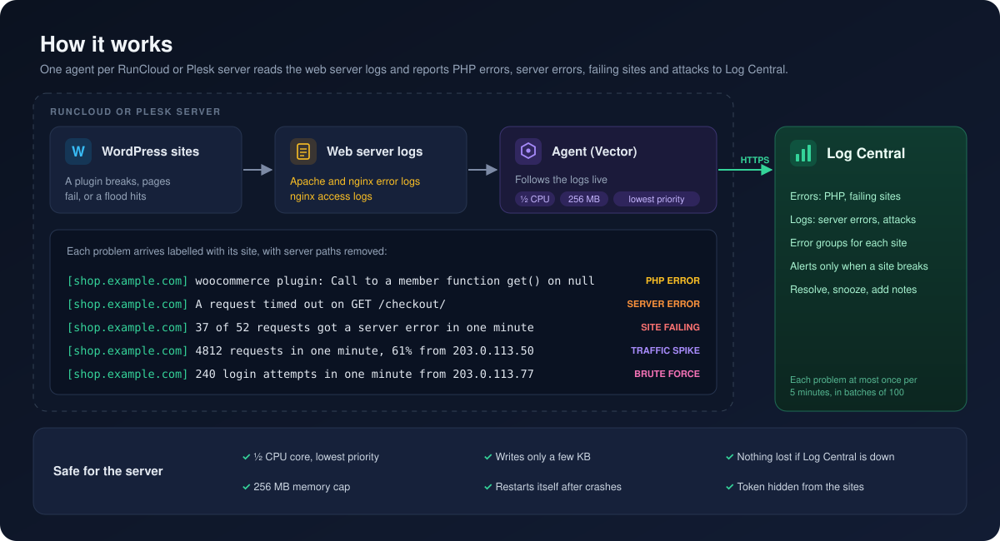
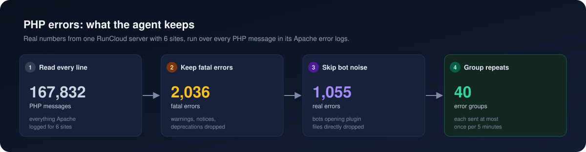

<p align="center">
  
</p>

<h1 align="center">log-central-agent</h1>

<p align="center">
  Watches every site on a RunCloud or Plesk server and reports problems to <a href="https://github.com/webimpian-os/log-central-portal">Log Central</a>.
</p>

<p align="center">
  <a href="https://github.com/webimpian-os/log-central-agent/actions/workflows/tests.yml"></a>
  <a href="https://github.com/webimpian-os/log-central-agent/releases/latest"></a>
  
  <a href="https://vector.dev"></a>
  
</p>

Problems that need a fix go to Log Central's **Errors** page, which alerts:

- **PHP errors:** a WordPress "critical error" page becomes an error you can see, named after the plugin, theme or Code Snippets snippet behind it.
- **Failing sites:** at least half of a site's requests in a minute, and at least 5, getting a server error (5xx), like a broken page or a database that's down.
- **Traffic spikes that break a site:** a spike where 1 in 10 requests or more fails.

Everything else worth knowing goes to the **Logs** page, which never alerts:

- **Server errors:** PHP not responding, requests timing out, PHP crashing mid-request, or nginx running out of connections.
- **Traffic spikes:** a site getting 3,000 or more requests in a minute, or ten times its usual traffic, with the top addresses, paths and user agents, so you can tell an attack from a busy day.
- **Brute force:** one address trying to log in 60 or more times a minute on `wp-login.php` or `xmlrpc.php`.
- **Worth a look:** bots and scanners probing the sites, database errors with their query, a full disk, missing files or libraries, broken regexes, PHP settings blocking a function or a path, and certificates that don't match the domain.

One install covers the whole server. Nothing goes into WordPress, and the sites never see the Log Central token.

## How it works



For PHP errors, most of what the logs hold is noise. On one real server with 6 sites:



## What it detects

**🚨 Errors page** (alerts)

| Problem | Shows up as |
|---|---|
| A PHP fatal or parse error | One group per site and code location, titled with the plugin, theme or snippet that caused it, with the request and stack trace |
| A PHP function switched off in the site's PHP settings, like `ignore_user_abort()` | "Disabled PHP function" |
| Most of a site's requests failing (500, 502, 503 or 504) | "Site failing", with the path that failed most |
| A traffic spike where 1 in 10 requests or more fails | "Traffic spike", with the top IPs, paths, user agents and status codes |

**📋 Logs page** (no alerts)

| Problem | Channel |
|---|---|
| PHP not responding, a request timing out, PHP crashing mid-request, nginx out of connections | `server`, at most 5 per site and kind every 5 minutes |
| A flood or DDoS the site handles: 3,000+ requests a minute, or 10× its usual traffic | `traffic`, with the top IPs, paths, user agents and status codes |
| 60+ login attempts a minute from one address | `security`, naming the address |
| A scanner sending a broken request to the REST batch endpoint, which trips a WordPress core bug | `security`, naming the address |
| A bot opening WordPress files directly, like `wp-includes/*.php` | `security`, naming the file and address |
| A WordPress database error, like a missing table or unknown column | `database`, with the error, the full query and the functions that ran it |
| SQL injection that reached the database: an `XPATH syntax error`, a `UNION` probing for the column count, or a query writing a file | `security`, with the query, so the vulnerable plugin can be found |
| No space left on the disk | `server` |
| A certificate that doesn't match the domain | `server` |
| A missing file or library, a broken regex, a file PHP can't write, or something the PHP settings block | `php`, named after the plugin or theme |

Rows below the first three are sent once an hour per site and problem, and at most 120 a minute per server. `php` rows and certificate mismatches last until someone fixes them, so they repeat every 6 hours.

**🔇 Ignored on purpose**

| Problem | Why |
|---|---|
| Other PHP warnings, notices and deprecations, like undefined array keys | Too noisy, and they don't break the page |
| A single 5xx response now and then | Mostly bots probing paths that don't exist. A timeout or PHP crash behind it is still reported |
| 5xx responses on the REST batch endpoint, `/wp-json/batch/v1` | Scanners break it on purpose, so they don't make a site look like it's failing. The scanner is still logged under `security` |

**🛡️ Servers page** (alerts)

Once a day the agent sends the server's patch state. It only reads: it never installs an update or reboots.

| Problem | Shows up as |
|---|---|
| A security update not installed for more than 3 days | "Security updates overdue", with the packages. On dnf servers only updates rated critical or important count; apt gives no rating, so every security update counts |
| A reboot pending for more than 14 days | "Reboot overdue", with the running and the installed kernel |
| An OS release that no longer gets security updates | "OS out of support". Ubuntu Pro extended support counts as supported |
| No patch report for 2 days | "Not reporting" |

Needs Log Central v1.16.0 or newer.

**❌ Not covered**

| Problem | Instead |
|---|---|
| Slow pages and API response times | Not yet: needs request times in the web server logs |
| Server CPU, memory or disk | A server monitor such as Beszel |
| Blocking an attack | Cloudflare, Imunify360 or the panel's firewall. The agent only detects |

## Install

As root on a RunCloud or Plesk server:

```
curl -fsSL https://github.com/webimpian-os/log-central-agent/releases/latest/download/install.sh | sudo bash
```

It installs the latest release, finds the panel itself, asks for the Log Central URL, app slug and app token, and checks them before changing anything. On a server that is neither, or looks like both, it stops without changing anything.

To skip the questions, copy the command from the app's Installation tab in Log Central, which fills everything in. It looks like this:

```
d="$(mktemp -d)" && curl -fsSL https://github.com/webimpian-os/log-central-agent/releases/latest/download/install.sh -o "$d/install.sh" && \
  echo 'PROJECT-KEY' | sudo bash "$d/install.sh" --url https://logs.example.com --app my-app --token-stdin; rm -rf "$d"
```

The key goes in on stdin, so it never shows in the server's process list.

| Panel | Reads |
|---|---|
| RunCloud (NGINX + Apache or native NGINX) | `/home/*/logs/apache2/*_error.log`, `/home/*/logs/nginx/*_error.log`, `/home/*/logs/nginx/*_access.log` |
| Plesk (nginx in front of Apache) | `/var/www/vhosts/system/*/logs/` `error_log`, `proxy_error_log`, `proxy_access_log`, `proxy_access_ssl_log` |

## Update

Servers don't update automatically. A new release only reaches a server when you run the install command there again. It installs the latest release and keeps the server's settings and token, so it won't ask for them again.

To install a specific version instead, use its tag:

```
curl -fsSL https://raw.githubusercontent.com/webimpian-os/log-central-agent/v1.2.0/install.sh | sudo bash
```

To update many servers from a checkout of the new tag, one at a time:

```
scripts/rollout.sh staging-server web-01 web-02
```

Update a staging server first, then one client server, then the rest.

## Full stack traces

PHP-FPM cuts every error message at 1,024 characters, so a WordPress stack trace usually stops after about five lines. To raise that to 8,192, the most Apache keeps per line, run as root:

```
curl -fsSL https://github.com/webimpian-os/log-central-agent/releases/latest/download/php-log-limit.sh | sudo bash
```

- It adds one small file per PHP version and changes nothing the panel manages.
- It tests each config before reloading PHP-FPM. A reload can end requests in progress, so run it at a quiet hour.
- PHP 7.2 and older keep their fixed limit.
- To remove it, run the same command with `sudo bash -s -- --undo`.

## Server safety

| Risk | Protection |
|---|---|
| High CPU | Capped at half of one core, at the lowest priority, so PHP and MySQL always come first. Under load it falls behind and catches up later |
| Out of memory | Capped at 256 MB, even during a flood. Over the cap, only the agent restarts. If the server runs low, the kernel stops the agent before any site |
| Disk full | Writes only a few KB. Its own logging is rate-limited |
| Log Central down | Stops reading and waits. Unsent errors stay in the log files and are sent once Log Central is back |
| Agent restart or crash | Picks up where Log Central last confirmed, so nothing is lost. A backlog is never counted as a traffic spike |
| Crash loop | Stops after 5 crashes in 10 minutes, then tries again every 15 minutes |
| Busy server | The installer refuses to run on low disk, low memory or high load, and stops the agent if the kernel isn't enforcing the limits above |

## Stress test

Vector 0.61.0 under the same limits as production (half a CPU core, 256 MB).

PHP errors, 100 sites:

| Scenario | Load | Avg CPU | Peak memory | Result |
|---|---|---|---|---|
| First install | 1 million lines (557 MB) already in the logs | 50% (the cap) | 74 MB | All read in 114 s |
| Error flood | 5,000 lines a second for 2 minutes | 31% | 70 MB | Kept up live |
| Log Central returning errors (503) | 5,000 lines a second for 1 minute | 18% | 69 MB | Retried, kept running |
| Log Central unreachable | 5,000 lines a second for 1 minute | 16% | 73 MB | Retried, kept running |
| Log Central back | 200 lines a second | 2% | 61 MB | Errors flowed again |

In total it read 2.2 million lines (1.2 GB) with a memory peak of 75 MB, no out-of-memory kills and no crashes.

Traffic, on a Plesk layout with 50 sites, 1% of requests ending in a PHP fatal error:

| Scenario | Load | Avg CPU | Peak memory | Result |
|---|---|---|---|---|
| Normal traffic | 1,000 requests a second for 2 minutes | 16% | 55 MB | Kept up live |
| DDoS on one site | 8,000 requests a second from random addresses, paths and user agents, for 2 minutes | 48% | 81 MB | Reported the spike, caught up 24 s after the attack stopped |
| Server-wide flood, 100 sites | 20,000 requests a second for 1 minute | 49% (the cap) | 105 MB | Reported the spike on all 100 sites. Fell behind and caught up 2 minutes after the flood stopped |
| Log Central down for 6 minutes | 2,000 requests a second | 6% | 73 MB | Paused reading, then sent the 175 errors that were waiting. No false spikes from the backlog |

In total it read 2.3 million requests (264 MB of logs) with a memory peak of 105 MB, no out-of-memory kills and no crashes.

For scale, the busiest real site on our two test servers peaked at 666 requests a minute, about 11 a second.

## Security

- The URL, app slug and token are readable only by the agent's own system user and root. Sites and their PHP code can't read them.
- The token can only send errors to one app. If it leaks, rotate it in Log Central and run the installer again.
- Plesk keeps each domain's logs readable only by root, so on Plesk the agent may read any file, but sees only `/var/www/vhosts/system`. Site files, Plesk's own secrets and `/etc/shadow` are hidden from it.

## Commands

```
systemctl status log-central-agent      # is it running?
journalctl -u log-central-agent -f      # what is it doing?
/opt/log-central-agent/bin/patch-report --print   # show the patch report without sending it
systemctl start log-central-agent-patches         # send the patch report now
curl -fsSL https://github.com/webimpian-os/log-central-agent/releases/latest/download/uninstall.sh | sudo bash
```

## Development

```
VECTOR=/path/to/vector scripts/test.sh     # run the tests
scripts/rollout.sh --url URL --app SLUG web-01 web-02   # install this checkout over SSH (token from LOG_CENTRAL_TOKEN)
```

To release: bump `AGENT_VERSION` in `install.sh`, commit, tag the commit with the same version (e.g. `v1.1.1`), push the tag and publish a GitHub release for it. Publishing attaches `install.sh`, `uninstall.sh` and `php-log-limit.sh`, so the latest download links move to the new version. Then update the servers as above.
